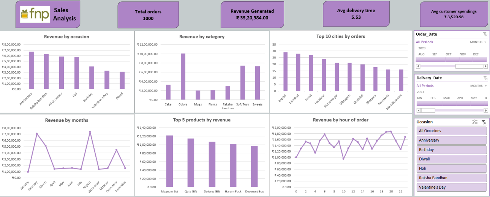

# FNP Sales Analysis – Excel Dashboard

An interactive Excel dashboard analysing 1,000 orders from FNP, a gifting business.

## Tools
Excel (Pivot Tables, Pivot Charts, Slicers)

## Files
- `FNP dashboard.xlsx`: the final dashboard
- CSV files: the dataset used
- PNG: screenshot of the dashboard

## KPIs
- Total orders: 1,000
- Revenue: ₹35,20,984
- Avg delivery time: 5.53
- Avg customer spend: ₹3,520.98

## Key Insights
- Anniversary, Raksha Bandhan and Holi bring the most revenue among occasions.
- Colors is the top category (~₹10L), far ahead of Soft Toys and Sweets.
- Revenue peaks in February and August. Most other months are low.
- Revenue is highest around 7-8 PM.
- Imphal, Dhanbad and Kavali lead in orders.

## Credits
- Built by following a tutorial: https://www.youtube.com/watch?v=Wom-eVrE4RY
- Dataset: https://github.com/Ayushi0214/FNP---Excel-Project
- Key insights were summarised with the help of an AI tool.
